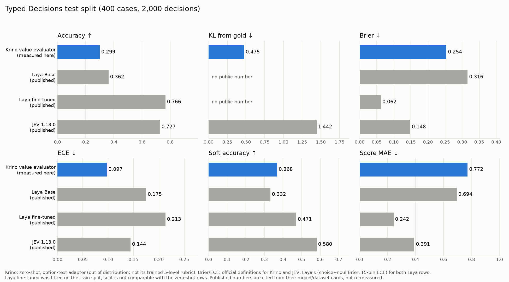

# Typed Decisions 评测报告：Krino value evaluator

- Benchmark：`LocalLLaMA/typed-decisions` @ `9ee69423ce0b0568c2d2d86e92c72ed7952fd084`，`all/test`，400 cases / 2000 decisions；test 文件 sha256 `4f294f218ea1da27…`
- 模型：`yuxiaohuang2004/krino_matrix` @ `79dc1368f0d13c27977a20aee18e0bd7f0612fa1`（即 `exp_C_opus1000_base_e20`），只推理，无额外训练、无调参
- 设备：NVIDIA GeForce RTX 4060 Laptop GPU；评测代码见 `benchmark/`，各文件 sha256 记录在 results.json

## 1. 接口兼容性（必读）

模型原生只回答一个问题：*How much value does this action bring toward the objective, given the state?*，输出固定的 5 档价值分布。
Benchmark 的 2000 个决策中，**原生兼容 0 个**，因此 **原生接口下没有可报告的 Benchmark 成绩**。不兼容原因：

| 原因 | 决策数 |
|---|---|
| choice: the model only outputs the fixed 5-level value rubric | 600 |
| noul: the model only outputs the fixed 5-level value rubric | 600 |
| score with 4 levels: the model has exactly 5 | 700 |
| score with 5 levels, but a different question and rubric than the trained one | 100 |

下文成绩来自**选项文本适配**：模型的决策头在每个选项自己的 [MASK] 处读取选项文本，所以直接把 Benchmark 自带的 criteria 作为选项文本输入，按 Benchmark 的选项顺序和键名输出概率。没有把任何选项映射到 5 档，没有改写标签含义，也没有用 gold 或 test 拟合温度（沿用模型自带的 temperature 1.682）。两个没有 criteria 的 noul 问题（invoice `duplicate`、security `credential_compromise`）使用固定文本 "The statement is true/false."。

这属于**分布外的零样本用法**：模型只在中文、单一“行动价值”问题上训练过，从未见过这些英文问题和选项集。另外中文 BERT 分词器把英文切得很碎，294/400 个 case 的 state 被截断（state token 中位数 348，上限约 192）。成绩覆盖全部 2,000 个决策，不是部分样本。

## 2. 整体结果（本次测量）

| Accuracy ↑ | KL ↓ | Brier ↓ | ECE ↓ | Soft Acc ↑ | Score MAE ↓ | p50 延迟 | p95 延迟 |
|---|---|---|---|---|---|---|---|
| 0.299 | 0.475 | 0.254 | 0.097 | 0.368 | 0.772 | 135.4 ms | 153.3 ms |

Accuracy / KL / Brier / ECE 按官方 `bench/score_with_jobs.py` 定义（全部 2,000 决策，ECE 10 bins）。官方脚本没有定义 Soft Acc 和 Score MAE，这两项按 Laya benchmark 的定义（Soft Acc：choice+noul 上 Σp·g；Score MAE：score 问题上 |期望档位 − gold score|）。按 Laya 定义的其余指标：accuracy 0.295，Brier（仅 choice+noul）0.258，ECE（15 bins）0.113。延迟：每个 case 一次请求（编码 + 前向 + softmax），单条、batch=1、fp32，NVIDIA GeForce RTX 4060 Laptop GPU。

参照：Uniform 基线 accuracy 0.308，Prior 基线 0.47（数据集卡片公开数据）。本次 accuracy 低于这两个不看输入的基线；ECE 较低主要是因为输出接近均匀、置信度低，不代表判断质量好。

## 3. 分组结果（本次测量）

| 分组 | n | Accuracy | KL | Brier | ECE | Soft Acc | Score MAE |
|---|---|---|---|---|---|---|---|
| workflow: `agent_trace_observability` | 500 | 0.276 | 0.393 | 0.202 | 0.080 | 0.327 | 0.754 |
| workflow: `customer_service` | 500 | 0.254 | 0.615 | 0.305 | 0.077 | 0.297 | 0.683 |
| workflow: `invoice_processing` | 500 | 0.466 | 0.532 | 0.322 | 0.170 | 0.441 | 0.771 |
| workflow: `security_incidents` | 500 | 0.202 | 0.360 | 0.188 | 0.232 | 0.409 | 0.878 |
| type: `noul` | 600 | 0.492 | 0.257 | 0.214 | 0.105 | 0.507 | – |
| type: `choice` | 600 | 0.175 | 0.629 | 0.303 | 0.112 | 0.230 | – |
| type: `score` | 800 | 0.249 | 0.523 | 0.248 | 0.081 | – | 0.772 |

## 4. 公开参考数据（引用，非本次重新测量）

以下数字均摘自公开的模型/数据集卡片，**不是本次重新测量**；评测提示、温度和样本处理可能与本次不同，仅供参考。

| 模型 | 模式 | 指标定义 | Accuracy | KL | Brier | ECE | Soft Acc | Score MAE | p50 延迟 |
|---|---|---|---|---|---|---|---|---|---|
| **Krino value evaluator（本次测量）** | zero-shot，选项文本适配 | 官方 | 0.299 | 0.475 | 0.254 | 0.097 | 0.368 | 0.772 | 135 ms |
| Krino（同上，Laya 定义） | | Laya | 0.295 | – | 0.258 | 0.113 | 0.368 | 0.772 | |
| Laya Base（公开引用） | zero-shot | laya | 0.362 | – | 0.316 | 0.175 | 0.332 | 0.694 | – |
| Laya fine-tuned（公开引用） | fitted on train (dataset card's second table; not comparable with zero-shot rows) | laya | 0.766 | – | 0.062 | 0.213 | 0.471 | 0.242 | – |
| JEV 1.13.0（公开引用） | zero-shot | official | 0.727 | 1.442 | 0.148 | 0.144 | 0.580 | 0.391 | 710 ms |

分组的公开 accuracy：

| 分组 | Krino（本次） | Laya 微调版（公开） | JEV 1.13.0（公开） |
|---|---|---|---|
| `agent_trace_observability` | 0.276 | 0.730 | – |
| `customer_service` | 0.254 | 0.764 | – |
| `invoice_processing` | 0.466 | 0.804 | – |
| `security_incidents` | 0.202 | 0.766 | – |
| `noul` | 0.492 | 0.857 | 0.775 |
| `choice` | 0.175 | 0.733 | 0.720 |
| `score` | 0.249 | 0.723 | 0.696 |

来源：
- Laya Base：https://huggingface.co/convaiinnovations/laya-typed-decisions (README.md @ e929ae5cf69bc34259cd2f95c9e91145b818b1f0)
- Laya fine-tuned：https://huggingface.co/convaiinnovations/laya-typed-decisions (README.md @ e929ae5cf69bc34259cd2f95c9e91145b818b1f0); accuracy also in https://huggingface.co/datasets/LocalLLaMA/typed-decisions (README.md @ 9ee69423ce0b0568c2d2d86e92c72ed7952fd084)
- JEV 1.13.0：https://huggingface.co/datasets/LocalLLaMA/typed-decisions (README.md @ 9ee69423ce0b0568c2d2d86e92c72ed7952fd084) (accuracy, KL, Brier, ECE, p50 latency, per-type accuracy); soft accuracy and score MAE as cited by https://huggingface.co/convaiinnovations/laya-typed-decisions (README.md @ e929ae5cf69bc34259cd2f95c9e91145b818b1f0), third-party
- Laya Base 公开数据中没有 KL 和延迟；Laya 微调版在 train split 上训练，属于数据集卡片的第二张表，与 zero-shot 行不可直接比较。

## 5. 数据泄漏检查

- 评测进程只下载 `all/test` parquet（加官方评分脚本，仅用于核对指标定义、不执行），train split 不进入本进程。
- 模型从未使用本 Benchmark 的 train 或 test 训练；温度在模型自己的 held-out 数据上拟合，本次未重新拟合。
- 扫描训练数据 2 个文件（`data/exp_C_opus1000/test.jsonl`, `data/exp_C_opus1000/train.jsonl`）：
  case id 命中 0；≥25 字符的 state/question 字符串 615 条，完全匹配命中 0；state 的 13-gram 20560 个，命中 0。
  训练数据含 610730 个汉字、758566 个拉丁字母（训练语料以中文为主）。
- 结论：未发现泄漏。
- 局限：只能检查本地可见的训练数据；预训练骨干（中文 BERT）的预训练语料无法检查。

## 6. 可复现性

- 数据集 revision `9ee69423ce0b0568c2d2d86e92c72ed7952fd084`，test 文件 sha256 `4f294f218ea1da27f3efef936359389c62ea4d3973a41457732990f1d31b647c`（不一致时拒绝运行）
- 模型 `yuxiaohuang2004/krino_matrix` revision `79dc1368f0d13c27977a20aee18e0bd7f0612fa1`，各文件 sha256 见 results.json
- 代码：git HEAD `a0ef2a79de992166d21237865b7024a15461db08`，benchmark 目录已提交且无改动：False；各源文件 sha256 见 results.json
- 环境：python 3.11.17，torch 2.6.0+cu124，transformers 5.20.2，seed 0
- 指标代码自检：用同一套代码重算数据集卡片的 Uniform 基线，得到 accuracy 0.277 / KL 0.444 / Brier 0.238 / ECE 0.045，公开值 0.308 / 0.444 / 0.238 / 0.169。KL、Brier 一致；accuracy、ECE 不同是因为均匀分布的 argmax 全部打平，结果取决于打平时取哪个选项（官方脚本取第一个选项，数据集卡片没有说明它的 Uniform 怎么处理打平），对非均匀的模型输出没有影响。
- 复现命令：`python benchmark/run_typed_decisions.py `
